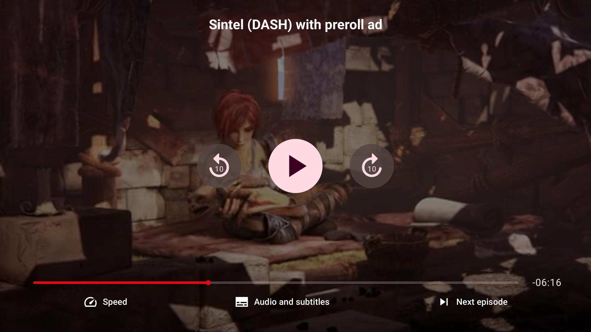

# Making a custom TV UI

Use `UIController` to arrange playback controls for a TV remote. You can use the provided TV components or add your own Compose for TV components.

## A basic player

Start with a player that has a single Play button:

```kotlin title="TvPlayer.kt"
@OptIn(ExperimentalTvUiApi::class)
@Composable
fun BasicTvPlayer() {
    UIController(
        config = THEOplayerConfig.Builder().build(),
        source = SourceDescription.Builder("https://example.com/stream.m3u8").build(),
        centerChrome = {
            PlayButton()
        }
    )
}
```

`UIController` creates and manages the `THEOplayerView` from `config` and loads `source`. Its slots place content in the `centerOverlay`, `errorOverlay`, `topChrome`, `centerChrome`, and `bottomChrome` areas. Pass an existing view to the `UIController(theoplayerView = ...)` overload when you manage the view yourself.

See the [`UIController` API reference](https://theoplayer.github.io/android-ui/api/android-ui-tv/com.theoplayer.android.ui.tv/-u-i-controller.html).

## Add more controls

Add a seek bar, time displays, a Live button, and a loading indicator:

```kotlin title="TvPlayer.kt"
@OptIn(ExperimentalTvUiApi::class)
@Composable
fun TvPlayerWithControls() {
    UIController(
        config = THEOplayerConfig.Builder().build(),
        source = SourceDescription.Builder("https://example.com/stream.m3u8").build(),
        centerOverlay = {
            LoadingSpinner()
        },
        errorOverlay = {
            ErrorDisplay()
        },
        centerChrome = {
            PlayButton()
        },
        bottomChrome = {
            SeekBar()
            Row(verticalAlignment = Alignment.CenterVertically) {
                CurrentTimeDisplay()
                Spacer(modifier = Modifier.weight(1f))
                DurationDisplay()
                LiveButton()
            }
        }
    )
}
```

- `SeekBar` lets viewers seek with the D-pad. Holding Left or Right scrubs through the timeline, and Center toggles play or pause.
- `CurrentTimeDisplay` shows the current time. Set `showRemaining = true` to show the remaining time.
- `DurationDisplay` shows the stream duration.
- `LiveButton` shows whether the player is at the live point and returns to it when selected.
- `LoadingSpinner` belongs in `centerOverlay`. It appears when playback is waiting for data.
- `ErrorDisplay` belongs in `errorOverlay`. It shows fatal playback errors.

The TV UI does not include the mobile `MuteButton`, fullscreen, or picture-in-picture controls.

## Add menus

`LanguageMenuButton()` and `SettingsMenuButton()` open the built-in language and settings menus. Call them inside a `UIController` slot, where the `UIControllerScope` also provides the `MenuScope` functions:

```kotlin title="TvPlayer.kt"
@OptIn(ExperimentalTvUiApi::class)
@Composable
fun TvPlayerWithMenus() {
    UIController(
        config = THEOplayerConfig.Builder().build(),
        source = SourceDescription.Builder("https://example.com/stream.m3u8").build(),
        bottomChrome = {
            Row {
                LanguageMenuButton()
                SettingsMenuButton()
            }
        }
    )
}
```

Open a specific built-in menu with `openMenu { PlaybackRateMenu() }`. For a custom menu, use `Menu(title = { ... }) { ... }`. Its content is a `ColumnScope`, so you can add TV Material `ListItem` rows or the built-in `QualityList`, `PlaybackRateList`, `AudioTrackList`, and `SubtitleTrackList` components.

```kotlin title="CustomMenu.kt"
@OptIn(ExperimentalTvUiApi::class)
@Composable
fun UIControllerScope.openCustomMenu() {
    openMenu {
        Menu(title = { Text("Playback options") }) {
            ListItem(
                selected = false,
                onClick = { closeCurrentMenu() },
                headlineContent = { Text("Done") }
            )
        }
    }
}
```

Menus open as side panels over the video. Back closes the current menu before the player controls or app handle it.

## Manage focus

The TV `UIController` puts its controls in a focus group and restores the previous focus when controls reappear. On first entry, focus moves to the first available control. `DefaultUI` directs focus to Play when a live stream has no seek bar.

In a custom layout, use `focusProperties` to choose where focus enters a group. This pattern directs focus to Play instead of the first button:

```kotlin title="PlayControls.kt"
@OptIn(ExperimentalTvUiApi::class)
@Composable
fun PlayControls() {
    val fr = remember { FocusRequester() }
    Row(
        modifier = Modifier
            .focusProperties { onEnter = { fr.requestFocus() } }
            .focusGroup()
    ) {
        PlayButton(modifier = Modifier.focusRequester(fr))
    }
}
```

`SeekButton` provides a separate seek-back or seek-forward button. It is used by the demo's Nitflex UI, but not by `DefaultUI`.

## Use the player's state

Use `LocalTHEOplayerView.current?.player` with the experimental state holders to read player state in a TV control. For example, show the bottom controls only after playback has started:

```kotlin title="TvPlayer.kt"
@OptIn(ExperimentalTvUiApi::class, ExperimentalPlayerStateApi::class)
@Composable
fun TvPlayerWithState() {
    UIController(
        config = THEOplayerConfig.Builder().build(),
        source = SourceDescription.Builder("https://example.com/stream.m3u8").build(),
        bottomChrome = {
            val firstPlayState =
                rememberFirstPlayState(LocalTHEOplayerView.current?.player)
            if (firstPlayState.firstPlay) {
                SeekBar()
            }
        }
    )
}
```

Unlike the mobile UI, the TV UI does not provide `Player.current`. Use state holders such as `rememberFirstPlayState`, `rememberPlayButtonState`, and `rememberSeekBarState` instead.

## More examples

The [`DefaultUI` source](https://github.com/THEOplayer/android-ui/blob/main/ui-tv/src/main/java/com/theoplayer/android/ui/tv/DefaultUI.kt) shows how the built-in TV player arranges the controls. The demo app's [`TvNitflexUI`](https://github.com/THEOplayer/android-ui/blob/main/app/src/main/java/com/theoplayer/android/ui/demo/tv/nitflex/TvNitflexUI.kt) and [`TvNitflexTheme`](https://github.com/THEOplayer/android-ui/blob/main/app/src/main/java/com/theoplayer/android/ui/demo/tv/nitflex/TvNitflexTheme.kt) show a more customized player.


