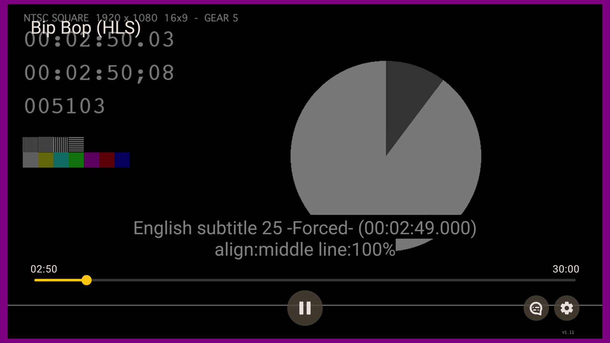
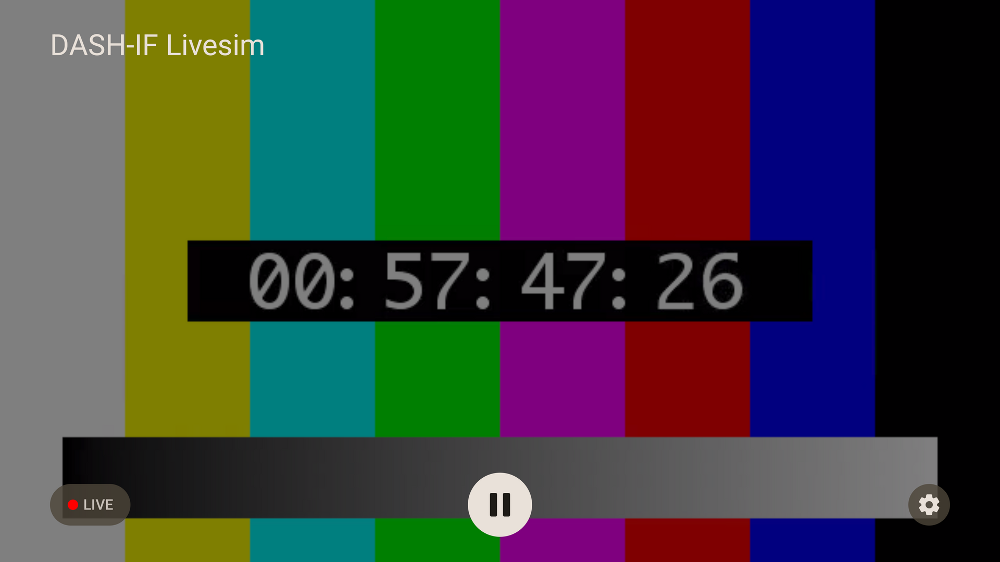
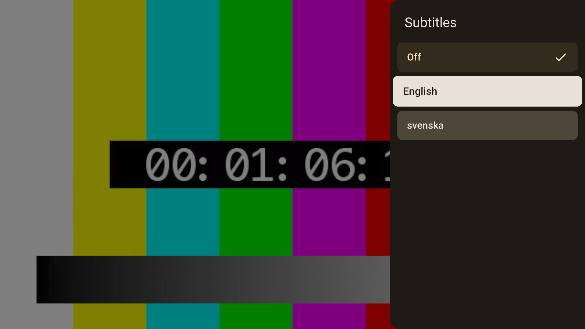
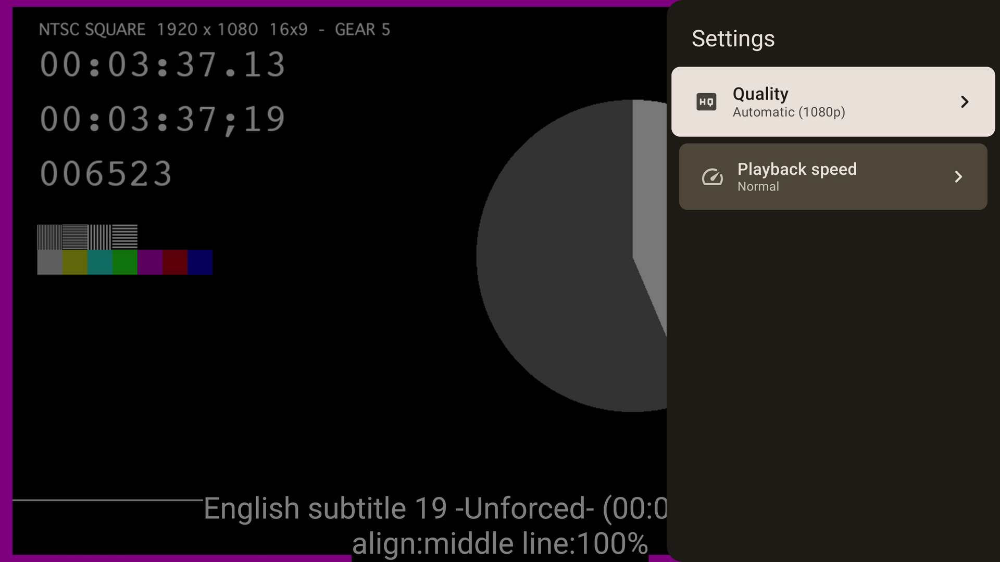
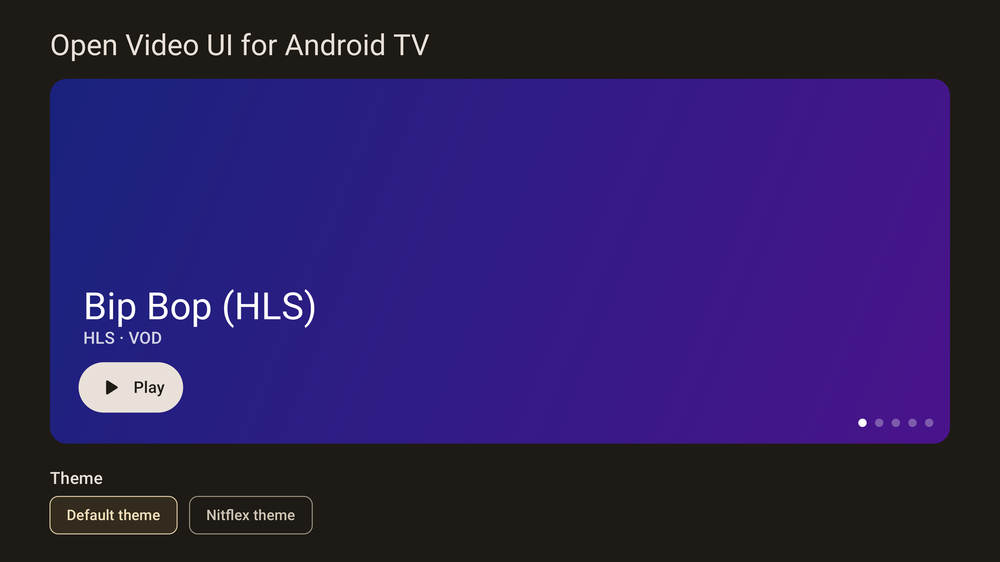

# Getting started on Android TV

`android-ui-tv` is an experimental UI library for Android TV, built with Compose for TV and `androidx.tv:tv-material`. It depends on `android-ui-common` for shared state holders, theme colors, and key handling. It does not depend on `android-ui` or the standard Material 3 library.

## Installation

Add THEOplayer and the TV UI library to your app's module-level `build.gradle` file. Add TV Material if you use its components, such as `Surface`.

```groovy title="build.gradle"
dependencies {
    implementation "com.theoplayer.theoplayer-sdk-android:core:11.+"
    implementation "com.theoplayer.android-ui:android-ui-tv:1.+"
    implementation "androidx.tv:tv-material:1.1.0"
}
```

The TV UI APIs are experimental. Add `@OptIn(ExperimentalTvUiApi::class)` to each composable or class that uses them.

## Set up your app for TV

Declare the TV feature, make touchscreen hardware optional, set a banner on the application, and add a `LEANBACK_LAUNCHER` intent filter to a TV activity. This follows the structure used by the [demo app manifest](https://github.com/THEOplayer/android-ui/blob/main/app/src/main/AndroidManifest.xml).

```xml title="AndroidManifest.xml"
<manifest xmlns:android="http://schemas.android.com/apk/res/android">
    <uses-feature
        android:name="android.software.leanback"
        android:required="false" />
    <uses-feature
        android:name="android.hardware.touchscreen"
        android:required="false" />

    <application android:banner="@drawable/tv_banner">
        <activity
            android:name=".tv.TvActivity"
            android:exported="true">
            <intent-filter>
                <action android:name="android.intent.action.MAIN" />
                <category android:name="android.intent.category.LEANBACK_LAUNCHER" />
            </intent-filter>
        </activity>
    </application>
</manifest>
```

See Google's [Get started with TV apps](https://developer.android.com/training/tv/get-started/create) guide for more information.

## Use the default UI

Wrap `DefaultUI` in a TV Material `Surface` inside `THEOplayerTvTheme`:

```kotlin title="TvPlayer.kt"
@OptIn(ExperimentalTvUiApi::class)
@Composable
fun TvPlayer() {
    THEOplayerTvTheme {
        Surface {
            DefaultUI(
                config = THEOplayerConfig.Builder().build(),
                source = SourceDescription.Builder(
                    "https://cdn.theoplayer.com/video/big_buck_bunny/big_buck_bunny.m3u8"
                ).build(),
                title = "Big Buck Bunny"
            )
        }
    }
}
```

`DefaultUI` does not set a content color. The `Surface` provides the correct colors for the text and icons. Without it, they can appear black against the black video.

The UI shows the title at the top left. Time displays sit above a full-width seek bar. Below it is a row with the Live button on the left, Play/Pause in the center, and Language and Settings buttons on the right. The seek bar receives initial focus when it is available.



See the [`DefaultUI` API reference](https://theoplayer.github.io/android-ui/api/android-ui-tv/com.theoplayer.android.ui.tv/-default-u-i.html).

## Control playback with a remote

When the controls are hidden, the player handles these keys:

| Key | Action |
| --- | --- |
| Center or Enter | Show the controls and toggle play or pause |
| Left or Right | Show the controls and seek backward or forward by 10 seconds |
| Other keys | Show the controls |

Media transport keys work while the controls are hidden or visible:

| Key | Action |
| --- | --- |
| Play/Pause | Toggle playback |
| Play | Start playback |
| Pause | Pause playback |
| Fast-forward or Rewind | Seek forward or backward by 10 seconds |

While the controls are visible, the D-pad moves focus between controls. Left and Right on the seek bar seek by 10 seconds. Holding either key scrubs through the timeline and pauses playback while scrubbing.

Back closes an open menu first. When the controls are visible, Back hides them. When they are hidden, the player leaves Back for the app's own `BackHandler`. Controls hide after 5 seconds without interaction while playing by default. Set `PlayerAnimations.controlsHideDelay` in `THEOplayerTvTheme` to change this delay.

## Live streams and ads

Live streams without DVR have no seek bar, so focus moves directly to the Play button.



DVR streams show the remaining time. During an ad, the UI hides time displays, Live, Language, and Settings controls. A seek bar remains for seekable streams.

## Language and settings menus

Language and Settings open side panels over the video. Back closes the open menu.





## Subtitles

Subtitles move away from the top and bottom controls while they are visible. Moving subtitles up requires THEOplayer 9.5.0 or later.

## Theming

`THEOplayerTvTheme` accepts a TV Material color scheme, typography, `PlayerColors`, and `PlayerAnimations`. Its default color scheme is dark. There is no automatic light and dark theme switch.

For example, customize the primary color with a TV Material dark color scheme:

```kotlin title="TvTheme.kt"
@OptIn(ExperimentalTvUiApi::class)
@Composable
fun TvPlayerTheme(content: @Composable () -> Unit) {
    THEOplayerTvTheme(
        colorScheme = darkColorScheme(primary = Color(0xFF80CBC4)),
        content = content
    )
}
```

## Use your own `THEOplayerView`

Pass an existing view to `DefaultUI(theoplayerView = ...)` or `UIController(theoplayerView = ...)`. Use `rememberTHEOplayerView(config)` when the view should be owned by the composition. It follows the composition's lifecycle and destroys the view when it leaves the composition.

If your activity creates the view, your activity owns its lifecycle. Forward `onPause`, `onResume`, and `onDestroy` to the view, as the demo's [`TvActivity`](https://github.com/THEOplayer/android-ui/blob/main/app/src/main/java/com/theoplayer/android/ui/demo/tv/TvActivity.kt) does:

```kotlin title="TvActivity.kt"
class TvActivity : ComponentActivity() {
    private lateinit var theoplayerView: THEOplayerView

    override fun onPause() {
        super.onPause()
        theoplayerView.onPause()
    }

    override fun onResume() {
        super.onResume()
        theoplayerView.onResume()
    }

    override fun onDestroy() {
        super.onDestroy()
        theoplayerView.onDestroy()
    }
}
```

## Differences from mobile

The TV UI has no Chromecast, fullscreen, picture-in-picture, or mute controls. The player is assumed to always fill the screen, and the remote controls the volume.

## Try the demo app

The demo app's [`TvActivity`](https://github.com/THEOplayer/android-ui/blob/main/app/src/main/java/com/theoplayer/android/ui/demo/tv/TvActivity.kt) opens a home screen with a stream carousel and theme chips.



To run it, create a **Television (1080p)** Android Virtual Device, run the `app` module, and open the app from the TV launcher. See the [TV demo source](https://github.com/THEOplayer/android-ui/tree/main/app/src/main/java/com/theoplayer/android/ui/demo/tv) for the full example.
